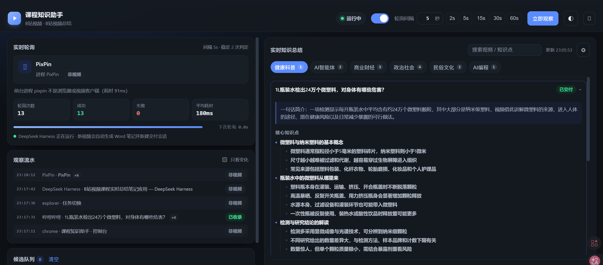
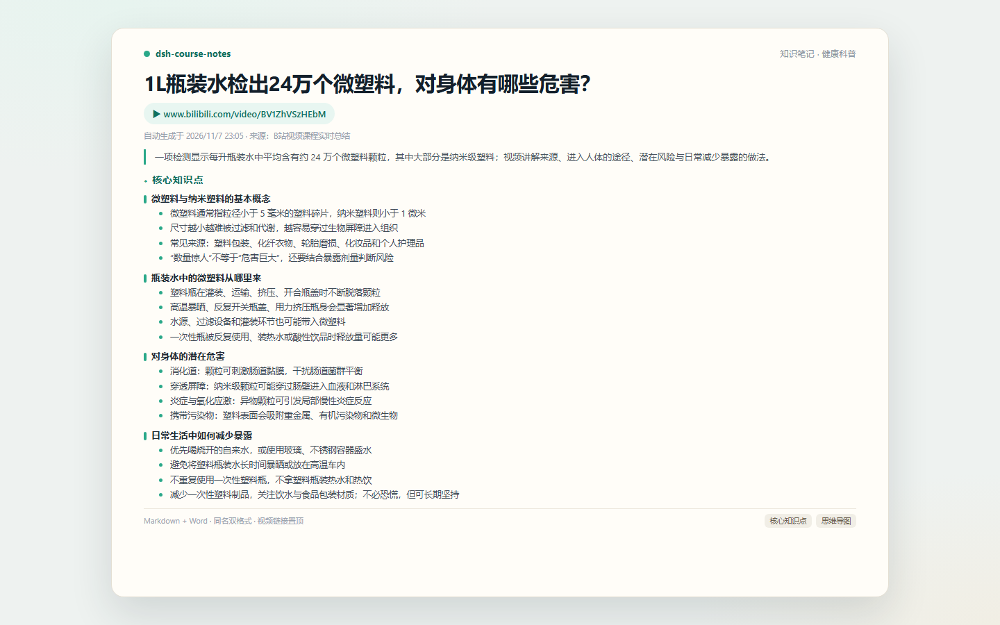

# dsh-course-notes

> 🎬 看 B 站课程，笔记自动送到你面前。

**一句话**：把「看视频 → 学科知识地图 → 同名 Markdown + Word → 新会话交付」串成一条自动化流水线。你只管看，剩下的它做。

[](https://www.npmjs.com/package/dsh-course-notes)
[](https://github.com/cplh/dsh-course-notes#前置条件)
[](https://github.com/cplh/dsh-course-notes#前置条件)
[](https://github.com/cplh/dsh-course-notes/blob/main/LICENSE)

## ⚡ 一键安装

```powershell
dsh plugin add dsh-course-notes
```

> 需要 Windows + DSH + **dsh-video-coursemap** + **dsh-memory-evolve**（开启会话编排）。插件市场索引有延迟时，这条命令始终可用。[完整前置条件](#前置条件)

## 📸 预览

| 前台：B 站视频 | 应用：实时知识总结 |
|---|---|
|  |  |

**交付的笔记**



> 从正在看的视频，到实时知识总结，再到视频链接置顶的 Markdown / Word 笔记。

## ✨ 装了它，能带来什么

- 🧠 **不用再手动记笔记**：coursemap 已经抓好的简介、字幕、弹幕、评论，自动整理成知识笔记。
- 📚 **同一门课越看越厚**：按学科归档，学习手册持续更新，笔记也按学科落盘。
- 🔗 **每份笔记都带视频链接**：开头置顶，点开就能回到原视频。
- 📄 **Markdown + Word 双份**：两个文件同名，md 方便检索/复制，docx 方便阅读/分享。
- 🔇 **零打扰**：空闲时不调用 LLM；异常只写日志，不影响 DSH 其他插件。
- 🛟 **不重复、不风暴**：已交付有记录；每轮最多交付 1 个；失败自动重试。

- **适合**：经常看 B 站课程/纪录片，想边看边沉淀笔记的人。
- **不适合**：只看短视频、不需要系统笔记，或不用 Windows 的人。

## 🎬 一条流水线，四步

| 步骤 | 谁来做 | 发生什么 |
|---|---|---|
| 1. 👀 看 | dsh-video-coursemap | 每 15 秒观察前台 B 站视频，识别标题 |
| 2. 🗂️ 整理 | coursemap | 判断学科，抓简介/字幕/弹幕/评论，更新学科手册 |
| 3. 📝 生成 | 本插件 | 抽取该视频章节，解析视频链接，写同名 md + docx |
| 4. 🚀 交付 | dsh-memory-evolve | 新建会话，同时展示两份文件，并写项目记忆 |

> 本插件不重复抓取、不重复调用总结 LLM；只消费 coursemap 的 `state.json` / `manuals`。

## 📦 安装

### 前置条件

| 依赖 | 说明 |
|---|---|
| DSH 桌面版 | 实测 0.2.2-rc.1；需要 agents / tools / agentPresets / present |
| Windows 10/11 x64 | coursemap 依赖 PowerShell + Win32 前台窗口检测 |
| dsh-video-coursemap 2.0.0 | 视频检测、学科分类、抓取、学习手册 |
| dsh-memory-evolve 0.1.0 | de_session 新建会话 + memory；需开启「会话编排」 |
| Python 3 + python-docx | 生成 Word；可用 DSH 捆绑运行时，或配置 pythonPath |
| PowerShell 5.1+ | coursemap 读取前台窗口 |
| LLM provider/model | DSH 中已配置；用于分类、总结与新会话 |
| 网络 | B 站接口与 LLM 接口 |

本包自身**零 npm 依赖**；上面两个插件是运行前置，不随本包安装。

### 三步装好

1. 安装 DSH 桌面版，确认 profile 可用。
2. 安装并启用两个前置插件（插件市场或下面的命令），并在 memory-evolve 的「记忆 → 会话编排」打开开关。

   ```powershell
   dsh plugin add https://github.com/linner1224/dsh-video-coursemap/releases/download/v2.0.0/dsh-video-coursemap-2.0.0.tgz
   dsh plugin add github:csyangwen/dsh-memory-evolve
   ```

3. 安装本插件：

```powershell
dsh plugin add dsh-course-notes
```

> 本包已带 `dsh.bundle.patch` / `cordis.patch.yml`，安装时自动插入插件行；不要再手动写一条 `insert`（重复 id 会报错）。

## ⚙️ 配置

装好后，在 profile 的 `cordis.patch.yml` 里加配置覆盖（**不要**再写 insert）：

```yaml
- id: dsh-course-notes
  config:
    coursemapOutputDir: 'C:\Users\<you>\课程知识地图'
    outputDir: 'C:\Users\<you>\课程笔记'
    sessionCwd: 'C:\Users\<you>\项目'
    # pythonPath: 'C:\Users\<you>\...\python.exe'
```

**基础配置**

| 键 | 默认 | 说明 |
|---|---|---|
| `coursemapOutputDir` | `~/课程知识地图` | 与 coursemap 输出一致 |
| `outputDir` | `~/课程笔记` | 笔记根目录 |
| `sessionCwd` | `outputDir` | 新会话 cwd / 记忆归属 |
| `pollIntervalMs` | `5000` | 差量轮询间隔 |
| `maxDeliveriesPerPoll` | `1` | 每轮最多交付数 |
| `backfillOnFirstRun` | `false` | 首次补发历史 |

**进阶配置**

| 键 | 默认 | 说明 |
|---|---|---|
| `maxAttempts` | `3` | 失败重试次数 |
| `provider` / `model` / `agentPreset` | `null` | 新会话路由覆盖 |
| `pythonPath` | `null` | 指定 python-docx 解释器 |
| `settingsFile` | `null` | 共享 JSON，读 `notesDir` |
| `stateDir` | `outputDir/.state` | 交付状态目录 |

如果 coursemap 用默认输出目录，`coursemapOutputDir` 可省略；`sessionCwd` 建议显式设置，否则项目记忆会落在 outputDir。

> `settingsFile` 用于本地控制台：加 `settingsFile: 'course-console/config.json'`，控制台写 `notesDir`，插件下一轮读取；`stateDir` 固定，换目录不丢交付记录。

## 🧰 两个工具

| 工具 | 用途 |
|---|---|
| `course_notes_status` | 查看输出目录、de_session、Python、已交付/待交付/失败计数、最近交付与错误 |
| `course_notes_deliver` | 手动补发单个视频；`title`（必填）、`subject`（可选）、`force`（已交付过是否重发） |

coursemap 侧还有 `course_map_status` / `course_map_scan`，可用于手动指定标题测试。

## 📝 你会得到什么

```text
知识笔记/
└── 健康科普/
    ├── 1L瓶装水检出24万个微塑料，对身体有哪些危害？.md
    └── 1L瓶装水检出24万个微塑料，对身体有哪些危害？.docx
```

**笔记开头示例**

```markdown
# 健康科普 · 1L瓶装水检出24万个微塑料，对身体有哪些危害？

> 视频链接：https://www.bilibili.com/video/BV1ZhVSzHEbM
> 一句话简介：每升瓶装水中平均含有约 24 万个微塑料颗粒，其中大部分是纳米级塑料。

### 核心知识点
- **微塑料与纳米塑料**：粒径小于 5 毫米的碎片 / 小于 1 微米的纳米塑料，越小越容易穿过生物屏障。
- **瓶装水中的来源**：瓶身脱落、高温暴晒、反复开盖、灌装与水源环节。
- **潜在危害**：肠道刺激、穿透屏障、炎症与氧化应激、携带污染物。
- **减少暴露**：烧开自来水、玻璃/不锈钢容器、不重复使用塑料瓶。
```

- 两份文件**同名**，内容一致；
- 开头置顶**视频链接**；
- 新会话里同时 `present` 两份文件；
- 交付记录写入 `delivered.json`，默认不重复。

## 🔄 它是怎么工作的


- **链接解析**：`poll.log` 的 bvid → B 站公开搜索反查 → 占位文案（不阻断交付）。
- **失败重试**：按 `maxAttempts` 重试；`de_session` 不可用时走 `agents.create` 兜底。
- **幂等**：`delivered.json` 用「学科 + 标题」去重；空闲零 LLM。

## ❓ FAQ

<details>
<summary><b>插件市场搜不到？</b></summary>

市场索引来自 awesome-dsh-plugin，PR 合并和每日重建有延迟。等不及直接 `dsh plugin add dsh-course-notes`。

</details>

<details>
<summary><b>装完没反应？</b></summary>

先确认 coursemap 和 memory-evolve 已启用、memory-evolve 的「会话编排」已开；再看 `course_notes_status` 和 `知识笔记/.state/delivery.log`。

</details>

<details>
<summary><b>同一个视频重复处理？</b></summary>

`delivered.json` 以「学科+标题」为键，正常不会。若 Word 生成失败导致状态没落盘，修好 `pythonPath` 后重试；不要反复 `course_map_scan` 同一标题（会追加重复章节）。

</details>

<details>
<summary><b>Word 报 <code>No module named 'docx'</code>？</b></summary>

coursemap 没找到带 python-docx 的 Python。确认 DSH 捆绑运行时存在并重启 DSH，或在配置里显式设置 `pythonPath`。

</details>

<details>
<summary><b>笔记里没有视频链接？</b></summary>

看 `poll.log` 是否有 `bvid=BV...`；没有会走 B 站搜索，仍失败就写占位，不阻断交付。可 `force` 重发或手动补链接。

</details>

<details>
<summary><b>没有新建会话？</b></summary>

看 `delivery.log` 和 `course_notes_status` 的 `lastError`；`de_session` 不可用时会走 `agents.create`；`provider/model` 为空会拒绝。

</details>

<details>
<summary><b>旧笔记只有 docx？</b></summary>

历史条目不会自动补 md/链接；用 `course_notes_deliver(force=true)` 逐条补齐（会新建会话）。

</details>

<details>
<summary><b>能改笔记保存目录吗？</b></summary>

可以。用控制台「笔记保存目录」，或直接改 `outputDir`；`stateDir` 保持固定，交付记录不会丢。

</details>

<details>
<summary><b>支持 macOS / Linux？</b></summary>

暂不支持。coursemap 依赖 Windows 前台窗口检测，本包声明 `os: win32`。

</details>

<details>
<summary><b>会消耗很多 token 吗？</b></summary>

空闲零 LLM；每个新视频约 1 次分类 + 1 次总结 + 1 个新会话回合。

</details>

<details>
<summary><b>配置改了不生效？</b></summary>

确认只改 `id: dsh-course-notes` 的 `config`，没有重复 `insert`；保存后等 HMR 重组，必要时重启 DSH。

</details>

## ⚠️ 限制与边界

**如果你需要跨平台、后台播放、或完全不想装 Python，这个插件暂时不适合。**

### 🖥️ 平台

- **仅 Windows 10/11 x64**：coursemap 依赖 PowerShell + Win32 前台窗口检测。
- **只看前台**：后台播放、最小化、其他显示器不会触发。

### 🌐 B 站接口

- 匿名接口限制：评论最多 3 条、字幕多数缺失、偶发 412。
- 链接反查可能因标题歧义失败；失败写占位，不阻断交付。

### 🤖 会话与成本

- 新会话需要同进程 `de_session`；DSH 关闭/跨实例无法程序化唤醒。
- 每个新视频约 1 次分类 + 1 次总结 + 1 个新会话回合；空闲零 LLM。
- 缺 python-docx 时 Word 失败并重试；没有只出 Markdown 的降级模式。

### 📄 输出

- Word 里的链接是纯文本；Markdown 里可点击。
- 旧笔记不会自动补 md/链接，需 `course_notes_deliver(force=true)`。

## 🛠️ 开发

```powershell
# 开发时 link 安装（与正式 bundle 安装二选一）
pnpm add link:<path-to>/dsh-course-notes
# 然后在 profile patch 手动 insert 本插件行

# 测试
node tests/plugin.test.mjs        # 10 个用例

# 预览 npm 包内容
npm pack --dry-run
```

发布流程见 [PUBLISHING.md](https://github.com/cplh/dsh-course-notes/blob/main/PUBLISHING.md)；包内已带 `cordis.patch.yml` 与 `dsh.bundle.patch`。

## 📄 License

MIT © 2026 Picasso。`lib/md2docx.py` 改编自 [dsh-video-coursemap](https://github.com/linner1224/dsh-video-coursemap)（MIT），见 [THIRD_PARTY_NOTICES.md](https://github.com/cplh/dsh-course-notes/blob/main/THIRD_PARTY_NOTICES.md)。

---

仓库：https://github.com/cplh/dsh-course-notes
npm：https://www.npmjs.com/package/dsh-course-notes
问题反馈：https://github.com/cplh/dsh-course-notes/issues
